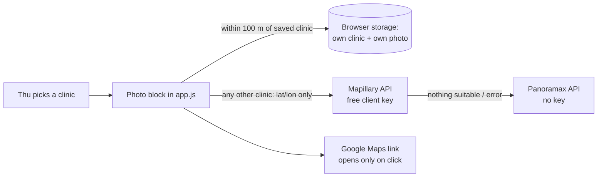

# 03 — Solution design: clinic photo when a clinic is chosen

Input: `docs/01-requirements.md`, `docs/02-functional-spec.md`. Status: draft for Gate 2.

## 1. Architecture overview

Everything runs in the visitor's browser, inside the existing static page. No server, no pipeline change, no new data file.

## 2. Stack choice

Keep the existing stack: plain HTML, CSS and JS in `site/`, no build step, D3 already loaded. The photo block is about 150 lines of plain JS plus a few CSS rules. No library is needed: `fetch` with `AbortController` for the time limit, `` for display, `<canvas>` to shrink the own photo, `localStorage` to keep it. This is the same pattern the page already uses for the saved clinic and service corrections.

Code layout (suggestion for the developer):
- `site/assets/photo.js` (new, loaded before `app.js`): pure functions with no page access, so they can be unit-tested in Node: distance and bearing, `pickPhoto(candidates, lat, lon, now)` (rule R2), parsing of each source's answer into one common shape `{src, url, by, licence, taken, page}`, credit line text (R5), Google Maps link (R6).
- `site/assets/app.js`: the photo block drawing (`dash.draw('hub-photo', ...)`, `dash.draw('clinic-photo', ...)`), lookups, memory cache, own-photo buttons.
- `site/index.html`: two `data-draw` containers and the hidden file input; `styles.css`: block styles using existing CSS variables.
- `tests/photo.test.mjs`: Node built-in test runner (`node --test`), no dependencies.

## 3. Integrations

| Source | Use | Key | Licence / credit | Privacy |
|---|---|---|---|---|
| **Mapillary** (Meta) — `graph.mapillary.com/images?lat=&lng=&radius=50&limit=50&fields=id,thumb_1024_url,captured_at,computed_compass_angle,compass_angle,geometry,is_pano,creator` | Primary. Best free street-photo coverage in Québec towns. | **Free client token required** (free developer account at mapillary.com, no billing, no card). The token is public in the page, which is how Mapillary's own web viewer works. Rate limit 10,000 searches per minute; we use one per clinic per visit. | Imagery CC BY-SA 4.0, commercial use allowed with credit. We show contributor, licence and a link to the photo. | Faces and plates blurred automatically. Receives: one clinic coordinate and the visitor's IP address. |
| **Panoramax** (French open commons, OpenStreetMap France / IGN) — `api.panoramax.xyz/api/search?bbox=<±~50 m>&limit=50` | Second source, and the only one until a Mapillary key exists. Checked live: answers without a key and allows calls from other websites (CORS). Coverage in Québec is thin (Québec City has some; a South Shore test area had none). | **None.** | Per photo: CC BY-SA 4.0 or Licence Ouverte (etalab-2.0); both allow reuse with credit. Read from the `license` field. Fields used: `view:azimuth`, `datetime`, `pers:interior_orientation.field_of_view` (360 = panorama, skipped), `providers` (contributor), `assets.sd.href`. | Faces and plates blurred automatically. Receives: one small box around a clinic and the visitor's IP. |
| **Google Maps** — `https://www.google.com/maps/search/?api=1&query=<lat>,<lon>` | Link only, opened by a click, new tab, `rel="noopener noreferrer"`. | None. Free, no account (official "Maps URLs"). | — | Google sees the coordinate only when the user clicks. |

Not chosen: Wikimedia Commons geosearch (no key, but almost never shows the clinic, so it would mislead), OpenStreetMap `image`/`mapillary` tags (rarely filled for dental listings; would need a pipeline change), Google Street View Static API (needs a billing account and card — breaks the 0 $ rule).

The Mapillary token sits in one constant in `photo.js`. Empty constant = Mapillary skipped, Panoramax only. So the feature ships and works before the key exists.

## 4. Data storage and authentication

- No new server-side data. `site/data` and `pipeline/` are unchanged.
- Own photo: `localStorage` key `dm-clinic-photo` = `{key: "<lat>,<lon>", img: "data:image/jpeg;base64,..."}`, shrunk to max 800 px (typically 80–200 KB, well under the ~5 MB browser limit). Deleted on "Remove photo", on clinic "Remove", and when the saved location changes.
- Lookup results: in-memory `Map` keyed by `lat,lon` (5 decimals), for the current visit only.
- No login. The page stays public; the Mapillary token is a read-only public client token, not a secret.

## 5. Security and Loi 25

- **Patient data:** none. This change reads, stores and sends no patient information. Real patient data never enters code, tests, docs or commits (tests use made-up coordinates and fake names).
- **What never leaves Thu's browser:** her clinic's name, its location (for photo purposes) and her own photo. Rule R1: no photo request for any point within 100 m of her saved clinic. The own photo is never sent anywhere, never in the URL, never in the repository (AC-5.7). Re-encoding through a canvas also strips GPS data hidden in the photo file.
- **What is sent to outside services:** for other clinics only, the coordinate of a public OpenStreetMap listing, plus the visitor's IP address, which any website call reveals. No names are sent.
- **No address leaks through "referrer":** all photo requests and images use `referrerPolicy: 'no-referrer'` / `referrerpolicy="no-referrer"`, and the Google link uses `noreferrer`. This matters because the page address can contain `?hub=<lat,lon>`.
- **Untrusted content:** text from sources (contributor names, licence) is inserted with `textContent`, never as HTML. Only `https:` image and link addresses are accepted.
- **Street photos and bystanders:** both sources blur faces and plates and publish under open licences (requirements §6).

## 6. Hosting, deployment and cost

Unchanged: GitHub Pages, deployed by the existing workflow when `main` changes. Work is done on branch `team/clinic-photo` and merged only after Gate 3.

**Estimated monthly cost: 0 $.** Mapillary and Panoramax are free; the Mapillary key is free with no billing. GitHub Pages is already in use.

## 7. Implementation plan (each increment testable on its own)

1. **Photo block with link and "not available" (no outside calls).** Containers under both clinic names, Hidden / Not available states, Google Maps link (R6), privacy line for own clinic, light/dark, 375 px. Test: pick clinics, links open the right pin in a new tab, nothing shows when no clinic is chosen. (US-3, US-4, US-7)
2. **Pure photo rules + unit tests.** `photo.js` with distance, bearing, `pickPhoto` (R2), source parsers, credit text (R5), privacy guard check (R1). `node --test` with the examples from the spec. (R1, R2, R5)
3. **Panoramax lookup (no key).** Loading state, 10 s limit (R4), stale-answer guard, memory cache (R9), image shown only after load, credit/date/note, no-referrer. Test with a Québec City listing that has coverage, with the network off, and with fast clinic switching. (US-1, US-6, US-8)
4. **Mapillary lookup ahead of Panoramax**, enabled when the free token constant is set. Test with and without the token, and with a wrong token (falls back cleanly). (US-1, R3)
5. **Own photo for "Your clinic".** Add / Replace / Remove, shrink to 800 px, storage with location key, error message, deleted on Remove and on location change, shown in Competition tab when Thu's clinic is the centre. Test with fake images; check nothing is sent over the network. (US-5, AC-2.4)
6. **Finish and QA.** Screen-reader labels, full regression (filters, `meta.json` labels, OSM credit, limits notes, no console errors), README "Data and licences" adds Mapillary and Panoramax credits, CHANGELOG. QA counts photos found for 20 sample Québec listings.

Rough effort: about 1 to 2 working days of team time.

## 8. Risks and open questions

| Risk / question | Impact | Mitigation |
|---|---|---|
| Coverage: many suburban Québec clinics will have no suitable photo, especially before the Mapillary key exists. | Thu often sees "Photo not available". | Google Maps link always present; QA reports the 20-listing hit rate so expectations are clear. |
| A photo shows the right spot but the wrong building or an old sign. | Over-trust. | Camera-direction filter (R2), date shown, note "The photo shows the location, not necessarily the clinic's current sign." |
| Mapillary key needs someone to create a free developer account (Meta login or email). | Mapillary stays off until done. | Feature works with Panoramax meanwhile. Action, not a cost: whoever owns the project's accounts registers it; the key is then pasted into `photo.js`. |
| Public key could be reused by others. | At worst our free quota is shared. | Read-only token, no billing attached; can be replaced in minutes. |
| A free source changes its API or terms. | Photos stop appearing. | Falls back to "Photo not available" (AC-8.2); one parser per source to update. |
| Thu picks her own clinic as centre before saving it in "Your clinic". | That one lookup sends her listing's coordinate to the provider. | Documented limit of R1; the listing is already public in OpenStreetMap. |
| **Existing behaviour, outside this change:** "Use your clinic" puts the clinic's coordinates in the page address (`?hub=`), which conflicts with the promise that her location never goes into the URL. | If Thu shares or bookmarks that link, her location travels with it. | Not fixed here (out of scope); this design makes sure photo requests don't leak it (no-referrer). Recommend a small follow-up fix. |
| Browser storage cleared or another device used. | Own photo gone. | Expected and stated on screen ("Saved in this browser only."). |
