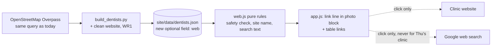
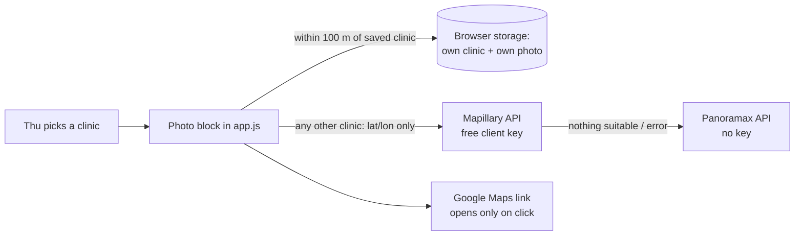

# 03 — Solution design

This file holds one section per iteration, newest first. Earlier iterations are kept as written.

- Iteration 2 (2026-11-15): link to each clinic's website
- Iteration 1 (2026-11-14, live): clinic photo when a clinic is chosen

---

# Iteration 2 — Link to each clinic's website

Input: `docs/01-requirements.md` (Iteration 2), `docs/02-functional-spec.md` (Iteration 2). Status: draft for Gate 2.

## 2.1 Architecture overview

One small pipeline change (keep the website tag OpenStreetMap already sends us) and one small page change (show it). No server, no key, no new outside service called by the page.

## 2.2 Stack choice

Keep the existing stack: Python pipeline, plain HTML/CSS/JS in `site/`, no build step, no new library. The website is one more field on data the pipeline already downloads, and the page needs only plain links, so nothing new is justified.

Code layout (suggestion for the developer):
- `pipeline/work/weblink.py` (new, standard library only, no shapely): `clean_website(tags) -> str | None` (WR1). Kept apart from `build_dentists.py` so it can be unit-tested without the geo libraries.
- `pipeline/work/build_dentists.py`: call `clean_website(t)`; add `web` to a row only when found (keeps the file small); WR3 duplicate merge (remember the kept row per key and copy `web` onto it if missing). Print the counts.
- `pipeline/refresh.py`: new option `--dentists` (see 2.4); add `dentists_web = {canada, quebec}` to the report.
- `site/assets/web.js` (new, loaded before `app.js`, same pattern as `photo.js`, global `dmWeb`): `safeUrl(s)` (WR1b, returns the URL or ''), `siteName(url)` (WR2), `isGeneric(name)` and `searchText(listing, town)` (WR4), `searchUrl(text)` (WR5), `ownListing(saved, listings)` (W10: closest within 30 m), `linkFor(centre, ctx)` returning `{kind: 'site'|'search'|'listed'|'none', url, label}` (2.1.1 states, WR6 with the iteration 1 guard `dmPhoto.lookupAllowed` reused for the 100 m rule).
- `site/assets/app.js`: `photoBlock` gets the link-line extra nodes from `dmWeb.linkFor` and adds them after the Google Maps link in every state; the block's redraw signature includes the link kind and URL. Table Name cells in `rival-table` and `clinic-rivals` become "name + small link". One helper `extLink(href, text, ariaLabel)` that sets `target="_blank"`, `rel="noopener noreferrer"`, `referrerpolicy="no-referrer"` and uses `textContent`.
- `site/index.html`: load `web.js`; one sentence in the competition note (spec 2.1.5).
- `styles.css`: one rule for the small table link (spacing, existing link colours). Nothing else.
- Tests: `tests/web.test.mjs` (`node --test`), `tests/test_weblink.py` (`python3 -m unittest`, standard library only), `tests/browser/web-incN.mjs` (same pattern as `tests/browser/photo-inc*.mjs`).

## 2.3 Data storage and integrations

| Item | Detail |
|---|---|
| Source | OpenStreetMap via the Overpass query already in `build_dentists.py` (`out center tags` already returns all tags, so the query does not change). Tags read: `website`, `contact:website`, `url`. Licence ODbL; the existing credit covers it. |
| Storage | `site/data/dentists.json`, optional field `web` (cleaned URL). Expected size increase: about 1,000 to 1,500 listings Canada-wide with a website × about 35 bytes, so roughly 50 KB on a 720 KB file. |
| Clinic websites | Only opened by Thu's click, in a new tab. Never fetched, checked or previewed (W8). |
| Google web search | `https://www.google.com/search?q=...`, link only, opened by click. Free, no account, no key. |
| Authentication | None. The page stays public. No secret of any kind. |
| Browser storage | Unchanged. No new key (US-15 not built, W13). |

## 2.4 Getting the websites into the data now

Today `refresh.py` rebuilds the listings only during the full yearly refresh (it exits early when Statistics Canada has nothing new, and `--no-download` skips the listings). So the websites would otherwise appear only in February.

New option: `python pipeline/refresh.py --dentists`
- Runs only `build_dentists.py` (Overpass download, about 2 to 3 minutes) into `pipeline/out/dentists.json`.
- Checks: at least 3,000 listings (existing check), and at least 75 % of the current file's count (new; stops a half-empty download from replacing good data). On failure: nothing in `site/data` changes, exit code 1 (AC-14.3).
- Writes the report (listing count, `dentists_web` Canada and Québec) and copies only `dentists.json` into `site/data`. `meta.json` and `last_release.txt` are not touched (the page shows no listing date, so no date label changes).
- The full yearly refresh (GitHub workflow) keeps working as before and now carries websites too; the workflow file does not change.

The developer runs this once on the feature branch, so the data change goes through `pipeline/` as CLAUDE.md requires, and commits the new `dentists.json`.

Side effect to expect: the refreshed file also brings any new, moved or removed OpenStreetMap listings since the last refresh. Saved service corrections are keyed by name and position, so a clinic that moved in OpenStreetMap loses its correction (rare, same as any yearly refresh). QA's 20-listing sample is taken by name and coordinates from the iteration 1 CHANGELOG table, so it stays the same 20.

## 2.5 Security and Loi 25

- **Patient data:** none. Website addresses are public listing data. Tests use fake clinics and fake addresses (for example `macliniquefictive.ca`); no real patient name or identifier anywhere.
- **What never leaves Thu's browser:** her saved clinic's name and location. The page never builds a search link for any point within 100 m of her saved clinic (or of a location saved earlier in the visit), so her clinic is never sent to Google by the page (W6, W11). Her card only shows a website that already sits in the public listing data.
- **What can leave, and only on a click:** the public listing's name, address and town in a Google search link; the clinic's own website address when its link is opened. The visitor's IP address is seen by whichever site she opens, as with any link.
- **No address leaks:** all new links use `rel="noopener noreferrer"` and `referrerpolicy="no-referrer"`, so neither the clinic site nor Google learns the dashboard address (which can contain `?hub=<lat,lon>`), and the opened tab cannot control the dashboard (AC-13.3).
- **Untrusted text:** website values come from volunteers. They are cleaned in the pipeline (WR1), checked again in the page (WR1b: only `http:`/`https:`, dotted host, no user part), and shown with `textContent`, never as HTML. The shown site name comes from the same parsed URL as the link (AC-13.4), so a link cannot show one site and open another.
- **No automatic requests:** plain links only; no prefetch, no preview, no link checking (AC-14.6). The page's only automatic outside call stays the existing Panoramax photo lookup.

## 2.6 Hosting, deployment and cost

Unchanged: GitHub Pages, published by the existing workflow when `main` changes. Work on branch `team/clinic-website`; merge to `main` only after Thu accepts at Gate 3.

**Estimated monthly cost: 0 $.** OpenStreetMap and Overpass are free; links to clinic sites and Google search are free and need no account or key.

## 2.7 Implementation plan (each increment testable on its own)

1. **Websites in the data.** `pipeline/work/weblink.py` (WR1) with Python unit tests from the spec 2.2 example table; `build_dentists.py` adds `web` and merges duplicates (WR3); `refresh.py --dentists` with the 75 % check and `dentists_web` counts in the report. Run it once on the branch and commit the new `dentists.json`. Test: unit tests pass; report shows the Canada and Québec counts (Québec should be near 140 of about 800); the page still loads with no console error and looks unchanged (the page ignores the new field). (US-13, US-14: AC-14.2, AC-14.3)
2. **Pure page rules + unit tests.** `site/assets/web.js` with `safeUrl`, `siteName`, `isGeneric`, `searchText`, `searchUrl`, `ownListing`, `linkFor`, loaded by the page but not used yet. `node --test` with the spec examples (WR1b, WR2, WR4 to WR6, including the 12 m / 70 m / 400 m example). (US-10, US-11, US-13)
3. **Link line at the Competition tab centre.** Website / Search / "Website not listed" / None states after "View on Google Maps", in every photo state; the note sentence (2.1.5). Browser check: a listing with a website, one without, a generic one with and without address, "Use your clinic" with a fake saved clinic, a competitor 70 m from it, fast switching, light and dark, 375 px, no request to any clinic site or Google on load or on redraw. (US-9, US-10, AC-11.3, AC-14.1, AC-14.4 to AC-14.6)
4. **"Your clinic" card.** Website of the W10 listing, never a search; follows Change and Remove. Browser check with fake saved clinics on and off a listing with a website. (US-11)
5. **Table links.** Small "Website" link in "Competing clinics" and "Nearest dental listings", with "Website of [clinic name]" for screen readers; check that clicking does not change centre, sort or service choice. (US-12)
6. **Finish and QA.** Full regression (photo block, Google Maps link, filters, `meta.json` labels, OpenStreetMap credit, limits notes, saved service corrections, no console errors), README ("Data and licences": websites come from OpenStreetMap; how to run `--dentists`; Layout table adds `web.js`), CHANGELOG. QA reports how many of the 20 sample Québec listings show a website link.

Browser checks follow the existing `tests/browser/` pattern (headless Chrome serving `site/` through DevTools), which works where `python3 -m http.server` is blocked; QA also runs them against `python3 -m http.server 8123 --directory site`.

Rough effort: about 1 working day of team time. Increments 2 to 5 do not depend on increment 1 being run against the live Overpass service: they can be tested with a small fake listings file.

## 2.8 Risks and open questions

| Risk / question | Impact | Mitigation |
|---|---|---|
| Only about 1 clinic in 6 has a website in OpenStreetMap (Québec). | Thu mostly sees "Website not listed · Search the web". | The search link is the designed main path (name plus town, address for generic names). Coverage grows at each refresh as volunteers add websites. |
| Overpass is slow or times out (a Canada-wide count timed out during requirements). | `--dentists` fails. | Nothing is replaced on failure; retry later. `build_dentists.py` already accepts a saved Overpass answer as a third argument for a retry from a file. |
| Wrong or outdated websites in OpenStreetMap. | Thu lands on a dead or wrong site. | Note on the page (AC-14.1); site name visible before clicking; she or a volunteer can fix it on openstreetmap.org. |
| Another clinic within 30 m is closer to Thu's saved point than her own listing. | Her card shows that clinic's website. | Documented limit (spec 2.4); she spots it at once; re-saving her clinic by picking her own listing fixes it. |
| Google search for a generic name with only an address may show several clinics. | Thu picks the right result herself. | Address and town narrow it; accepted. |
| A search link could be built for Thu's clinic before she saves it in "Your clinic". | Only if she clicks, Google receives her public listing's name and town. | Same documented limit as iteration 1 R1; the data is already public in OpenStreetMap. |
| Existing issue, not in scope: "Use your clinic" puts her clinic's coordinates in the page address (`?hub=`). | A shared or bookmarked link carries her location. | New links use no-referrer, so it does not leak through them. Follow-up fix still recommended (from iteration 1). |
| Host names with accented letters (rare) are refused by WR1. | That clinic shows the search link instead. | Accepted for simplicity; also avoids look-alike addresses. |

No open question needs Thu: all choices above are defaults she can change at Gate 3.

---

# Iteration 1 — Clinic photo when a clinic is chosen

Input: `docs/01-requirements.md`, `docs/02-functional-spec.md`. Status: draft for Gate 2.

## 1. Architecture overview

Everything runs in the visitor's browser, inside the existing static page. No server, no pipeline change, no new data file.

## 2. Stack choice

Keep the existing stack: plain HTML, CSS and JS in `site/`, no build step, D3 already loaded. The photo block is about 150 lines of plain JS plus a few CSS rules. No library is needed: `fetch` with `AbortController` for the time limit, `` for display, `<canvas>` to shrink the own photo, `localStorage` to keep it. This is the same pattern the page already uses for the saved clinic and service corrections.

Code layout (suggestion for the developer):
- `site/assets/photo.js` (new, loaded before `app.js`): pure functions with no page access, so they can be unit-tested in Node: distance and bearing, `pickPhoto(candidates, lat, lon, now)` (rule R2), parsing of each source's answer into one common shape `{src, url, by, licence, taken, page}`, credit line text (R5), Google Maps link (R6).
- `site/assets/app.js`: the photo block drawing (`dash.draw('hub-photo', ...)`, `dash.draw('clinic-photo', ...)`), lookups, memory cache, own-photo buttons.
- `site/index.html`: two `data-draw` containers and the hidden file input; `styles.css`: block styles using existing CSS variables.
- `tests/photo.test.mjs`: Node built-in test runner (`node --test`), no dependencies.

## 3. Integrations

| Source | Use | Key | Licence / credit | Privacy |
|---|---|---|---|---|
| **Mapillary** (Meta) — `graph.mapillary.com/images?lat=&lng=&radius=50&limit=50&fields=id,thumb_1024_url,captured_at,computed_compass_angle,compass_angle,geometry,is_pano,creator` | Primary. Best free street-photo coverage in Québec towns. | **Free client token required** (free developer account at mapillary.com, no billing, no card). The token is public in the page, which is how Mapillary's own web viewer works. Rate limit 10,000 searches per minute; we use one per clinic per visit. | Imagery CC BY-SA 4.0, commercial use allowed with credit. We show contributor, licence and a link to the photo. | Faces and plates blurred automatically. Receives: one clinic coordinate and the visitor's IP address. |
| **Panoramax** (French open commons, OpenStreetMap France / IGN) — `api.panoramax.xyz/api/search?bbox=<±~50 m>&limit=50` | Second source, and the only one until a Mapillary key exists. Checked live: answers without a key and allows calls from other websites (CORS). Coverage in Québec is thin (Québec City has some; a South Shore test area had none). | **None.** | Per photo: CC BY-SA 4.0 or Licence Ouverte (etalab-2.0); both allow reuse with credit. Read from the `license` field. Fields used: `view:azimuth`, `datetime`, `pers:interior_orientation.field_of_view` (360 = panorama, skipped), `providers` (contributor), `assets.sd.href`. | Faces and plates blurred automatically. Receives: one small box around a clinic and the visitor's IP. |
| **Google Maps** — `https://www.google.com/maps/search/?api=1&query=<lat>,<lon>` | Link only, opened by a click, new tab, `rel="noopener noreferrer"`. | None. Free, no account (official "Maps URLs"). | — | Google sees the coordinate only when the user clicks. |

Not chosen: Wikimedia Commons geosearch (no key, but almost never shows the clinic, so it would mislead), OpenStreetMap `image`/`mapillary` tags (rarely filled for dental listings; would need a pipeline change), Google Street View Static API (needs a billing account and card — breaks the 0 $ rule).

The Mapillary token sits in one constant in `photo.js`. Empty constant = Mapillary skipped, Panoramax only. So the feature ships and works before the key exists.

## 4. Data storage and authentication

- No new server-side data. `site/data` and `pipeline/` are unchanged.
- Own photo: `localStorage` key `dm-clinic-photo` = `{key: "<lat>,<lon>", img: "data:image/jpeg;base64,..."}`, shrunk to max 800 px (typically 80–200 KB, well under the ~5 MB browser limit). Deleted on "Remove photo", on clinic "Remove", and when the saved location changes.
- Lookup results: in-memory `Map` keyed by `lat,lon` (5 decimals), for the current visit only.
- No login. The page stays public; the Mapillary token is a read-only public client token, not a secret.

## 5. Security and Loi 25

- **Patient data:** none. This change reads, stores and sends no patient information. Real patient data never enters code, tests, docs or commits (tests use made-up coordinates and fake names).
- **What never leaves Thu's browser:** her clinic's name, its location (for photo purposes) and her own photo. Rule R1: no photo request for any point within 100 m of her saved clinic. The own photo is never sent anywhere, never in the URL, never in the repository (AC-5.7). Re-encoding through a canvas also strips GPS data hidden in the photo file.
- **What is sent to outside services:** for other clinics only, the coordinate of a public OpenStreetMap listing, plus the visitor's IP address, which any website call reveals. No names are sent.
- **No address leaks through "referrer":** all photo requests and images use `referrerPolicy: 'no-referrer'` / `referrerpolicy="no-referrer"`, and the Google link uses `noreferrer`. This matters because the page address can contain `?hub=<lat,lon>`.
- **Untrusted content:** text from sources (contributor names, licence) is inserted with `textContent`, never as HTML. Only `https:` image and link addresses are accepted.
- **Street photos and bystanders:** both sources blur faces and plates and publish under open licences (requirements §6).

## 6. Hosting, deployment and cost

Unchanged: GitHub Pages, deployed by the existing workflow when `main` changes. Work is done on branch `team/clinic-photo` and merged only after Gate 3.

**Estimated monthly cost: 0 $.** Mapillary and Panoramax are free; the Mapillary key is free with no billing. GitHub Pages is already in use.

## 7. Implementation plan (each increment testable on its own)

1. **Photo block with link and "not available" (no outside calls).** Containers under both clinic names, Hidden / Not available states, Google Maps link (R6), privacy line for own clinic, light/dark, 375 px. Test: pick clinics, links open the right pin in a new tab, nothing shows when no clinic is chosen. (US-3, US-4, US-7)
2. **Pure photo rules + unit tests.** `photo.js` with distance, bearing, `pickPhoto` (R2), source parsers, credit text (R5), privacy guard check (R1). `node --test` with the examples from the spec. (R1, R2, R5)
3. **Panoramax lookup (no key).** Loading state, 10 s limit (R4), stale-answer guard, memory cache (R9), image shown only after load, credit/date/note, no-referrer. Test with a Québec City listing that has coverage, with the network off, and with fast clinic switching. (US-1, US-6, US-8)
4. **Mapillary lookup ahead of Panoramax**, enabled when the free token constant is set. Test with and without the token, and with a wrong token (falls back cleanly). (US-1, R3)
5. **Own photo for "Your clinic".** Add / Replace / Remove, shrink to 800 px, storage with location key, error message, deleted on Remove and on location change, shown in Competition tab when Thu's clinic is the centre. Test with fake images; check nothing is sent over the network. (US-5, AC-2.4)
6. **Finish and QA.** Screen-reader labels, full regression (filters, `meta.json` labels, OSM credit, limits notes, no console errors), README "Data and licences" adds Mapillary and Panoramax credits, CHANGELOG. QA counts photos found for 20 sample Québec listings.

Rough effort: about 1 to 2 working days of team time.

## 8. Risks and open questions

| Risk / question | Impact | Mitigation |
|---|---|---|
| Coverage: many suburban Québec clinics will have no suitable photo, especially before the Mapillary key exists. | Thu often sees "Photo not available". | Google Maps link always present; QA reports the 20-listing hit rate so expectations are clear. |
| A photo shows the right spot but the wrong building or an old sign. | Over-trust. | Camera-direction filter (R2), date shown, note "The photo shows the location, not necessarily the clinic's current sign." |
| Mapillary key needs someone to create a free developer account (Meta login or email). | Mapillary stays off until done. | Feature works with Panoramax meanwhile. Action, not a cost: whoever owns the project's accounts registers it; the key is then pasted into `photo.js`. |
| Public key could be reused by others. | At worst our free quota is shared. | Read-only token, no billing attached; can be replaced in minutes. |
| A free source changes its API or terms. | Photos stop appearing. | Falls back to "Photo not available" (AC-8.2); one parser per source to update. |
| Thu picks her own clinic as centre before saving it in "Your clinic". | That one lookup sends her listing's coordinate to the provider. | Documented limit of R1; the listing is already public in OpenStreetMap. |
| **Existing behaviour, outside this change:** "Use your clinic" puts the clinic's coordinates in the page address (`?hub=`), which conflicts with the promise that her location never goes into the URL. | If Thu shares or bookmarks that link, her location travels with it. | Not fixed here (out of scope); this design makes sure photo requests don't leak it (no-referrer). Recommend a small follow-up fix. |
| Browser storage cleared or another device used. | Own photo gone. | Expected and stated on screen ("Saved in this browser only."). |
